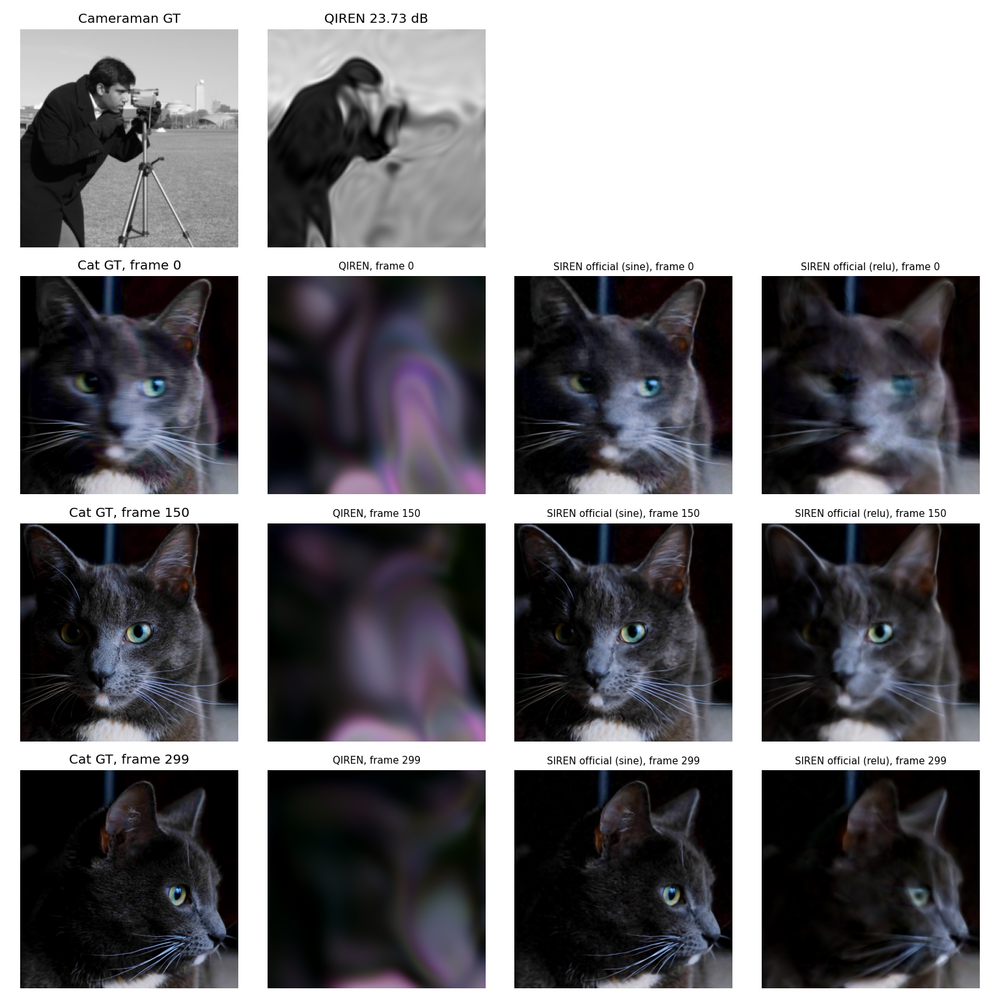
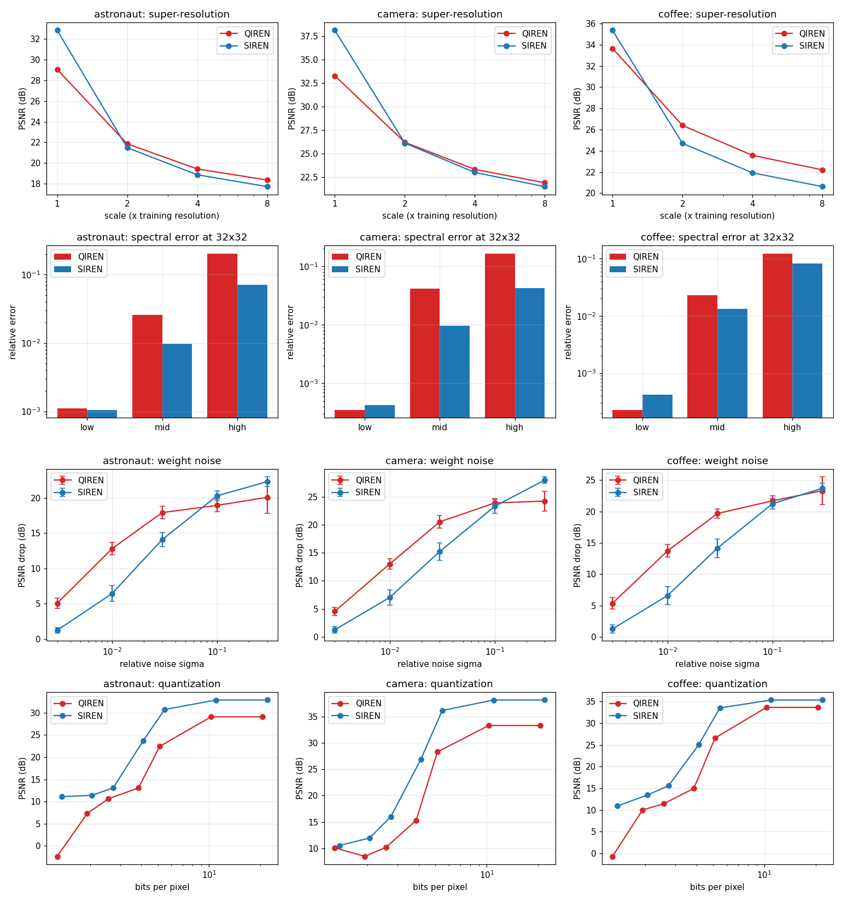

# QIREN vs. SIREN

A reproduction of **QIREN** (*Quantum Implicit Neural Representations*, ICML 2024, [arXiv:2406.03873](https://arxiv.org/abs/2406.03873)) with the authors' official code, and a head-to-head comparison with **SIREN** (*Implicit Neural Representations with Periodic Activation Functions*, NeurIPS 2020, [arXiv:2006.09661](https://arxiv.org/abs/2006.09661)).

| # | Experiment | Question |
|---|---|---|
| 1 | QIREN reproduction | Do we get the numbers in Table 1 of the QIREN paper? |
| 2 | QIREN vs. SIREN at QIREN's scale | With ~700 parameters each, which model is better? |
| 3 | QIREN on SIREN's original tasks | With SIREN's tasks, training settings and test protocol, which model is better? |
| 4 | Head-to-head tests of the best weights | In which situations does each model win? (no retraining) |

[Final verdict](#final-verdict-who-wins) · [Repository layout](#repository-layout) · [Reproducibility notes](#reproducibility-notes)

The SIREN paper itself was reproduced separately (Figs. 1, 3–6 and the cat video); see [SIREN-Reproduction-colab](https://github.com/baixuelin307-byte/SIREN-Reproduction-colab). Its figures are also under [`figures/siren_reproduction/`](figures/siren_reproduction).

All runs were done on Google Colab (NVIDIA RTX PRO 6000 Blackwell for Experiment 3).

---

## Code and environment

| | Source | Version |
|---|---|---|
| QIREN | [GGorMM1/QIREN](https://github.com/GGorMM1/QIREN) | commit `56ab4010ee3fbb3371c9d5d5f5284a8c41d4e6f3` |
| SIREN | [vsitzmann/siren](https://github.com/vsitzmann/siren) | official repository |
| Software | Python 3.13, PyTorch 2.14, PennyLane 0.45.1 | full list in [`results/exp1_qiren_vs_paper/environment.json`](results/exp1_qiren_vs_paper/environment.json) |

**Patches to the QIREN code.** The model, optimizer, loss and data transforms are unchanged.
- `qml.RZ(inputs[j], ...)` → `qml.RZ(inputs[..., j], ...)`, needed for batched inputs in current PennyLane.
- Removed an unused `qiskit` import.
- Added `--image`, `--seed` and `--ckpt_dir` options to `train.py`, so that runs are separated and reproducible.

---

## Experiment 1: QIREN reproduction (QIREN paper, Table 1)

**Setup.** Official `train.py` with its defaults: Adam, lr 0.03, MSE loss, 300 epochs (600 for Astronaut). Five models × four tasks × five seeds (0–4), 100 runs in total. Parameter counts match the paper exactly: QIREN 649/657, SIREN 691/701, ReLU/Tanh 831/841, ReLU+RFF 791.

**Protocol**
- **Evaluation mode:** `model.train()`, as in the official code, so BatchNorm uses batch statistics. In `eval()` mode QIREN's error is two orders of magnitude larger.
- **Checkpoint:** best epoch, i.e. the lowest representation MSE over all epochs, for every model.
- **Super-resolution (SR):** the model trained on 32×32 is queried on a 64×64 grid. We use the seed that is best on the 32×32 task, not the one that is best on the 64×64 ground truth.
- **Reported value:** best of 5 seeds, MSE ×10⁻³ (lower is better).
- **SIREN:** tuned as described in Experiment 2, because the paper does not publish its SIREN hyperparameters.

**Representation, MSE ×10⁻³ (ours / paper)**

| Task | ReLU | Tanh | ReLU+RFF | SIREN (tuned) | **QIREN** |
|---|---|---|---|---|---|
| Sound | 6.90 / 6.8 | 12.88 / 14.0 | 5.40 / 6.0 | 4.75 / 5.5 | **6.26 / 5.5** |
| Astronaut | 12.41 / 9.9 | 18.10 / 20.7 | 6.97 / 5.1 | 2.08 / 9.0 | **4.98 / 4.0** |
| Camera | 2.91 / 2.7 | 6.32 / 5.8 | 2.73 / 1.9 | 0.62 / 1.5 | **1.87 / 1.1** |
| Coffee | 4.30 / 4.2 | 15.81 / 14.8 | 4.20 / 4.9 | 1.16 / 2.3 | **1.72 / 1.5** |

**Super-resolution 32→64, MSE ×10⁻³ (ours / paper)**

| Task | ReLU | Tanh | ReLU+RFF | SIREN (tuned) | **QIREN** |
|---|---|---|---|---|---|
| Astronaut | 37.58 / 33.8 | 43.07 / 47.8 | 59.58 / 39.9 | 28.38 / 77.0 | **26.02 / 24.3** |
| Camera | 11.37 / 11.3 | 15.25 / 15.2 | 15.71 / 13.3 | 9.72 / 26.3 | **9.54 / 7.9** |
| Coffee | 13.50 / 13.5 | 26.80 / 26.7 | 18.19 / 23.9 | 13.55 / 15.7 | **9.18 / 9.4** |

Sources: [`summary_best_epoch_all_models.csv`](results/exp1_qiren_vs_paper/baseline_best_epoch/summary_best_epoch_all_models.csv) for the images, [`runs/`](results/exp1_qiren_vs_paper/runs) for Sound, and [`qiren_best_vs_paper.csv`](results/exp1_qiren_vs_paper/best_epoch_runs/qiren_best_vs_paper.csv) for QIREN against the paper.

**Findings**
- **Pipeline confirmed:** the untuned baselines (ReLU, Tanh) mostly match the paper within about 10–15%. The largest gap is ReLU on Astronaut, +25%.
- **QIREN super-resolution reproduced:** Astronaut +7%, Camera +21%, Coffee −2% relative to the paper.
- **QIREN representation 14–70% worse than the paper:** Sound +14%, Astronaut +24%, Camera +70%, Coffee +15%.
- **Paper's ranking against the classical baselines holds:** QIREN beats ReLU, Tanh and ReLU+RFF on every image task, in both representation and super-resolution.

---

## Experiment 2: QIREN vs. SIREN at QIREN's scale

**Setup.** Same tasks, network sizes (~700 parameters) and protocol as Experiment 1. Three variants:
- **SIREN default:** the QIREN repository's defaults, ω₀ = 1, lr = 0.03.
- **SIREN tuned:** grid ω₀ ∈ {1, 10, 30} × lr ∈ {1e-4, 1e-3, 1e-2, 3e-2}, selected on a separate seed (123). Chosen: ω₀ = 30 and lr = 1e-3 for Sound; ω₀ = 10 and lr = 1e-2 for the images ([`siren_selected_hyperparams.json`](results/exp2_qiren_vs_siren/siren_selected_hyperparams.json)).
- **QIREN:** official settings, lr = 0.03.

**Representation, MSE ×10⁻³ (lower is better)**

| Task | SIREN default | SIREN tuned | **QIREN** | Paper SIREN | Paper QIREN |
|---|---|---|---|---|---|
| Sound | 10.11 | **4.75** | 6.26 | 5.5 | 5.5 |
| Astronaut | 13.39 | **2.08** | 4.98 | 9.0 | 4.0 |
| Camera | 7.81 | **0.62** | 1.87 | 1.5 | 1.1 |
| Coffee | 10.24 | **1.16** | 1.72 | 2.3 | 1.5 |

**Super-resolution 32→64, MSE ×10⁻³ (lower is better)**

| Task | SIREN default | SIREN tuned | **QIREN** | Paper SIREN | Paper QIREN |
|---|---|---|---|---|---|
| Astronaut | 40.36 | 28.38 | **26.02** | 77.0 | 24.3 |
| Camera | 18.70 | 9.72 | **9.54** | 26.3 | 7.9 |
| Coffee | 23.64 | 13.55 | **9.18** | 15.7 | 9.4 |

**Generalization ratio = SR error ÷ representation error (lower means less degradation at the unseen resolution)**

| Task | SIREN tuned | **QIREN** |
|---|---|---|
| Astronaut | 13.6 | **5.2** |
| Camera | 15.7 | **5.1** |
| Coffee | 11.7 | **5.3** |

**Findings**
- **Representation:** tuned SIREN wins on all four tasks. QIREN beats SIREN only when SIREN uses the repository defaults.
- **Super-resolution:** QIREN is on par with tuned SIREN or better on all three images (Coffee: 9.18 vs. 13.55). It degrades 2–3× less when moving to the unseen 64×64 grid.
- **Paper's SIREN numbers:** they fall between our default and tuned SIREN. In a separate ω₀ × lr grid, no setting matched the paper on all three images within ±30% ([`siren_grid_vs_paper.csv`](results/exp2_qiren_vs_siren/siren_grid_vs_paper/siren_grid_vs_paper.csv)). The authors' SIREN configuration cannot be recovered from public information.
- **Cost:** one QIREN run takes about 20–25× longer than a classical run of the same size, because the quantum circuit is simulated.

---

## Experiment 3: QIREN on SIREN's original tasks

**Setup.** Each task uses SIREN's official data pipeline (`dataio`), SIREN's training settings and SIREN's test protocol. QIREN keeps its own architecture: 8 qubits, 2 re-uploading layers, BatchNorm in train mode. ω₀ and SIREN's initialization do not apply to QIREN.

| Task | Training (SIREN's settings) | Test (SIREN's protocol) | QIREN params | SIREN params |
|---|---|---|---|---|
| Image fitting: cameraman 256×256 | Adam, lr 1e-4, 15,000 steps, full image | PSNR on the full image | 657 | 198,401 |
| Audio: Bach, Counting | Adam, lr 1e-4, 9,001 steps, full signal | MSE on the full signal | 649 | 198,145 |
| Video: Cat, 300 × 512 × 512 | Adam, lr 1e-4, 100,000 steps, 0.38% of pixels per step | PSNR of every frame, mean ± std | 683 | 3,155,971 |

Every model is tested from its best checkpoint. SIREN audio was trained with the same training loop as QIREN; SIREN video is our run of SIREN's official `train_video.py`.

**Results**

| Task | Metric | ReLU | Tanh | ReLU P.E. | RBF-ReLU | **SIREN** | **QIREN** |
|---|---|---|---|---|---|---|---|
| Image fitting | PSNR (dB) ↑ | 25.83 | 26.05 | 43.25 | 31.26 | **56.74** | 23.73 |
| Audio: Bach | MSE ↓ | – | – | – | – | **6.05 × 10⁻⁶** | 2.42 × 10⁻² |
| Audio: Counting | MSE ↓ | – | – | – | – | **2.31 × 10⁻⁴** | 7.43 × 10⁻³ |
| Video: Cat | PSNR (dB) ↑ | 25.52 ± 1.12 | – | – | – | **31.77 ± 1.00** | 18.25 ± 0.95 |

- **Image fitting, classical models:** values come from our SIREN reproduction and are the mean PSNR over the last 1,000 training steps. QIREN's mean over its last 1,000 steps is 23.68 dB, so the two definitions differ by only 0.05 dB here.
- **Video, ReLU column:** SIREN's official network with ReLU activations.
- **Data:** [`test_results.csv`](results/exp3_qiren_on_siren_tasks/test_results.csv), plus a `result.json` and best weights for each run.



**Findings**
- **SIREN wins every task by a wide margin:** +33 dB on the image, +13.5 dB on the video, and an audio MSE 30–4,000× lower.
- **QIREN still captures coarse structure:** it gets the silhouette of the cameraman and the colour layout of the video, but no fine detail.
- **Parameter efficiency:** on the image, QIREN with 657 parameters is within about 2 dB of ReLU and Tanh, which have about 300× more parameters.
- **Video training plateaued early:** QIREN's best checkpoint, evaluated every 1,000 steps, was at step 4,000 of 100,000.
- **The gap is mostly capacity:** SIREN has 300–4,600× more parameters here. These results show that QIREN does not yet scale to SIREN-sized problems; they do not show that a quantum model is intrinsically worse.

### Tasks QIREN cannot run without changing the model

| SIREN task | Why not |
|---|---|
| Poisson image reconstruction (gradient, Laplacian, composite) | The loss supervises ∂f/∂x or Δf |
| SDF (Thai Statue, room) | The loss needs ∇f (Eikonal and normal terms) |
| Helmholtz, FWI | The loss needs Δf |

QIREN applies BatchNorm in train mode in every layer, so the output at one coordinate depends on the whole batch. Subtracting the batch mean also makes the network invariant to a global shift of the inputs, so derivatives with respect to the input are not point-wise. With SIREN's `diff_operators`, the computed **Laplacian is identically zero** (measured maximum 7×10⁻⁶, which is numerical noise), and the gradient field always sums to zero over the batch. Running these tasks would require removing or freezing BatchNorm, which would no longer be QIREN.

### Exact fast simulation of QIREN's circuit

At 256×256 (65,536 coordinates), the official PennyLane `default.qubit` simulation takes **27 s per step on CPU and 8 s per step on GPU**, so 15,000 steps would take 33–113 hours. The circuit, however, has the form

|ψ(x)⟩ = SEL(w₂) · D(x) · SEL(w₁⁽²⁾) · D(x) · SEL(w₁⁽¹⁾) |0⟩

The StronglyEntanglingLayers unitaries `SEL` depend only on the weights, and `D(x) = RZ(x₀) ⊗ … ⊗ RZ(x₇)` is diagonal. We therefore build each 256×256 unitary once per step and apply the circuit to all coordinates as batched matrix multiplications. This is **mathematically identical** to the official circuit, not an approximation.
- **Checked on every run:** before training, the fast layer is compared with the official PennyLane layer on the same weights and inputs, and the run stops if they disagree. Maximum differences were 1×10⁻⁶ on the outputs and 2×10⁻⁷ on the gradients (float32 rounding).
- **Compatible weights:** parameter names are unchanged, so the saved weights load into the official model. Strip the `net.` prefix that the training wrapper adds.
- **Code:** [`code/exp3_qiren_on_siren_tasks/`](code/exp3_qiren_on_siren_tasks).

---

## Experiment 4: head-to-head tests of the best weights

**Setup.** No training. We take the best QIREN and the best (tuned) SIREN from Experiment 2: ~700 parameters each, trained on 32×32 images.
- **Weights:** for each model and image we take the best-epoch checkpoint of each of the 5 seeds, then keep the seed with the lowest 32×32 error. Selection uses only the training resolution, so none of the tests below influenced the choice.
- **Chosen seeds:** QIREN 0 / 1 / 1 and SIREN 4 / 4 / 1 for Astronaut / Camera / Coffee.
- **Evaluation mode:** `model.train()`, as in Experiments 1 and 2.
- **PSNR:** pixels in [−1, 1], PSNR = 10·log₁₀(4 / MSE).

Four tests:

| Test | What we do | Question |
|---|---|---|
| A. Multi-scale super-resolution | Query the 32×32 model on 32, 64, 128 and 256 grids | Who degrades more slowly at unseen resolutions? |
| B. Frequency bands | 2-D FFT of the 32×32 reconstruction; relative error in the low, mid and high thirds of the spectrum | Who captures coarse structure and fine detail better? |
| C. Weight noise | Gaussian noise with std σ × (RMS of each parameter tensor), 20 trials per level | Who is more robust to parameter perturbations (a proxy for imprecise quantum gates)? |
| D. Weight quantization | Symmetric uniform per-tensor quantization to 16, 8, 6, 4, 3 and 2 bits | Used as an image codec, who keeps more quality per bit? |

### A. Multi-scale super-resolution: PSNR (dB), higher is better

| Task | Scale | QIREN | SIREN | Winner |
|---|---|---|---|---|
| Astronaut | ×1 (training) | 29.05 | **32.84** | SIREN |
| | ×2 | **21.87** | 21.49 | QIREN |
| | ×4 | **19.43** | 18.88 | QIREN |
| | ×8 | **18.37** | 17.73 | QIREN |
| Camera | ×1 (training) | 33.29 | **38.12** | SIREN |
| | ×2 | **26.23** | 26.14 | QIREN |
| | ×4 | **23.35** | 23.02 | QIREN |
| | ×8 | **21.92** | 21.52 | QIREN |
| Coffee | ×1 (training) | 33.66 | **35.37** | SIREN |
| | ×2 | **26.39** | 24.70 | QIREN |
| | ×4 | **23.57** | 21.92 | QIREN |
| | ×8 | **22.20** | 20.62 | QIREN |

### B. Relative spectral error at 32×32, lower is better

| Task | Band | QIREN | SIREN | Winner |
|---|---|---|---|---|
| Astronaut | low | 0.0011 | 0.0011 | tie |
| | mid | 0.0258 | **0.0098** | SIREN |
| | high | 0.2039 | **0.0705** | SIREN |
| Camera | low | 0.0004 | 0.0004 | tie |
| | mid | 0.0419 | **0.0097** | SIREN |
| | high | 0.1664 | **0.0428** | SIREN |
| Coffee | low | **0.0002** | 0.0004 | QIREN |
| | mid | 0.0233 | **0.0133** | SIREN |
| | high | 0.1235 | **0.0822** | SIREN |

*The script counts low-band ties at 4 decimals as SIREN wins; they are shown here as ties.*

### C. Weight noise: PSNR drop (dB) at 32×32, mean of 20 trials, lower is better

| σ | Astronaut QIREN | Astronaut SIREN | Camera QIREN | Camera SIREN | Coffee QIREN | Coffee SIREN |
|---|---|---|---|---|---|---|
| 0.003 | 5.05 | **1.22** | 4.54 | **1.25** | 5.37 | **1.29** |
| 0.01 | 12.78 | **6.42** | 13.02 | **7.03** | 13.71 | **6.59** |
| 0.03 | 17.90 | **14.07** | 20.54 | **15.25** | 19.68 | **14.17** |
| 0.1 | **18.92** | 20.28 | 23.90 | **23.31** | 21.71 | **21.24** |
| 0.3 | **20.06** | 22.28 | **24.24** | 28.00 | **23.33** | 23.72 |

### D. Weight quantization: PSNR (dB) at 32×32, higher is better

| Bits | Astronaut QIREN | Astronaut SIREN | Camera QIREN | Camera SIREN | Coffee QIREN | Coffee SIREN |
|---|---|---|---|---|---|---|
| 32 (original) | 29.05 | **32.84** | 33.29 | **38.12** | 33.66 | **35.37** |
| 16 | 29.05 | **32.83** | 33.29 | **38.12** | 33.66 | **35.37** |
| 8 | 22.42 | **30.69** | 28.28 | **36.13** | 26.61 | **33.54** |
| 6 | 13.04 | **23.70** | 15.32 | **26.92** | 14.97 | **25.03** |
| 4 | 10.63 | **13.07** | 10.21 | **16.03** | 11.45 | **15.59** |
| 3 | 7.28 | **11.40** | 8.49 | **11.97** | 9.99 | **13.44** |
| 2 | −2.34 | **11.09** | 10.11 | **10.56** | −0.70 | **10.91** |

At 32×32, one bit per parameter corresponds to 0.64 (QIREN) or 0.68 (SIREN) bits per pixel.

### Scoreboard (number of cases won)

| Test | QIREN : SIREN |
|---|---|
| A. Training resolution (×1) | 0 : **3** |
| A. Unseen resolutions (×2, ×4, ×8) | **9** : 0 |
| B. Low-frequency error | 1 : 0 (2 ties) |
| B. Mid- and high-frequency error | 0 : **6** |
| C. Weight noise, σ ≤ 0.03 (image still usable) | 0 : **9** |
| C. Weight noise, σ ≥ 0.1 (both destroyed, drops of 19–28 dB) | 4 : 2 |
| D. Quantization, 16 and 8 bits | 0 : **6** |
| D. Quantization, 6 to 2 bits | 0 : **12** |



*Rows: A. super-resolution, B. spectral error per band, C. PSNR drop under weight noise, D. PSNR under quantization. Red: QIREN; blue: SIREN.*

**Findings**
- **The ranking flips at unseen resolutions.** SIREN wins every training-resolution case by 1.7–4.8 dB, and QIREN wins all 9 unseen-resolution cases, by 0.1–1.7 dB. QIREN's lead is largest on Coffee: 1.6–1.7 dB at ×4 and ×8.
- **QIREN represents a smoother, lower-frequency function.** Low-frequency errors are equal, but SIREN's mid- and high-frequency errors are 1.5–4× lower. This is consistent with the flip in A: QIREN fits fewer fine details of the 32×32 grid and interpolates more smoothly between its pixels, while SIREN fits that detail and generalizes worse. We present this as an interpretation, not a proven cause.
- **QIREN is much more sensitive to its parameters.**
  - *Weight noise:* at σ = 0.003, QIREN loses about 5 dB and SIREN about 1.2 dB; at σ = 0.01, QIREN loses about 13 dB and SIREN about 6–7 dB. QIREN's wins at σ ≥ 0.1 come only after both models are already destroyed, so they carry no information.
  - *Quantization:* at 8 bits QIREN loses 5–7 dB and SIREN about 2 dB; at 6 bits and below QIREN breaks down.
  - *Implication:* this is a practical concern for running QIREN on real quantum hardware, where gate parameters are never exact.
- **Caveats.** These tests use one seed per model, the best one. In train mode, QIREN's BatchNorm uses the statistics of the queried grid, so test A partly measures this mechanism. It is part of how QIREN works, and it is also how the paper evaluates super-resolution.

Code: [`code/exp4_head_to_head/`](code/exp4_head_to_head). Full output: [`results/exp4_head_to_head/exp4_output.txt`](results/exp4_head_to_head/exp4_output.txt).

---

## Final verdict: who wins?

| | Experiment 1: QIREN paper | Experiment 2: same size (~700 params) | Experiment 3: SIREN's tasks | Experiment 4: best weights head-to-head |
|---|---|---|---|---|
| **Setting** | QIREN's tasks and protocol | QIREN's tasks, SIREN tuned | SIREN's tasks, settings and test protocol | Exp. 2 weights, no retraining |
| **Fitting accuracy** | QIREN beats ReLU, Tanh, ReLU+RFF | 🏆 **SIREN (tuned)** | 🏆 **SIREN**, by a wide margin | 🏆 **SIREN**: 3 : 0 at training resolution; 6 : 0 on mid/high frequencies |
| **Super-resolution / generalization** | QIREN beats ReLU, Tanh, ReLU+RFF | 🏆 **QIREN**: ties or wins SR, degrades 2–3× less | not tested by SIREN's protocol | 🏆 **QIREN**: 9 : 0 at ×2, ×4, ×8 |
| **Parameter efficiency** | similar sizes by design | similar sizes by design | 🏆 **QIREN**: within ~2 dB of ReLU on the image with 300× fewer parameters | similar sizes by design |
| **Robustness and compression** | – | – | – | 🏆 **SIREN**: 9 : 0 under usable weight noise, 18 : 0 under quantization |
| **Compute cost** | QIREN ~20–25× slower | QIREN ~20–25× slower | QIREN infeasible without our exact fast simulation | – |
| **Applicable tasks** | all | all | 🏆 **SIREN**: QIREN cannot do derivative-based tasks (BatchNorm) | – |

**Overall, SIREN wins.** It fits signals more accurately at every scale we tested, scales to large images, audio and video, supports derivative-based tasks such as Poisson, SDF and Helmholtz, and is far more robust to weight noise and quantization (Experiment 4).

**QIREN's real strength is generalization at a very small parameter budget.** At ~700 parameters it degrades far less than SIREN on unseen resolutions: it ties or beats tuned SIREN at ×2 (Experiment 2) and wins all 9 cases from ×2 to ×8 (Experiment 4). Its smoother, lower-frequency representation is consistent with this advantage, and it is also why it loses on fine detail at the training resolution. Its main weakness besides scale is sensitivity to its parameters, which matters for real quantum hardware. This supports the QIREN paper's super-resolution claim. The paper's claim that QIREN *represents* signals better than SIREN holds only against an untuned SIREN.

**How faithful is the reproduction?** The experimental pipeline reproduces the paper (baselines match, and QIREN's ranking against the classical baselines holds). QIREN's absolute representation errors are 14–70% higher than reported. Part of this is run-to-run variation (see below), and the paper's undisclosed SIREN settings make that comparison impossible to match exactly.

---

## Repository layout

```
notebooks/
  QIREN_paper_aligned_reproduction.ipynb   # Experiments 1 and 2 (all cells and outputs)
  SIREN_reproduction.ipynb                 # SIREN paper reproduction: Figs. 1, 3–6, cat video
code/
  exp3_qiren_on_siren_tasks/
    1_train_image_fitting.py               # QIREN, cameraman 256×256
    2_train_audio.py                       # QIREN and SIREN, Bach and Counting
    3_train_video.py                       # QIREN, cat video
    4_test_all.py                          # test every model with SIREN's protocol, plus figure
  exp4_head_to_head/
    0_setup.py                             # restore QIREN code, data loaders and model builder
    1_head_to_head_tests.py                # tests A-D on the best weights, tables, scoreboard and figures
  collect_results.py                       # check all results on Drive and package this repository
results/
  exp1_qiren_vs_paper/                     # 100 run logs, best-epoch summaries, environment
  exp2_qiren_vs_siren/                     # SIREN default and tuning runs, selected hyperparameters, grid
  exp3_qiren_on_siren_tasks/               # result.json and best weights per run, test_results.csv
  exp4_head_to_head/                       # full output of Experiment 4
  siren_reproduction/                      # Fig. 5 metrics
figures/
  exp3/                                    # QIREN vs. SIREN on SIREN's tasks
  exp4/                                    # Experiment 4 curves
  siren_reproduction/                      # SIREN paper figures we reproduced
```

Each file in `code/` is a self-contained Colab cell: it mounts Google Drive, fetches both official repositories and patches QIREN as described above. The training scripts resume from their last checkpoint if interrupted.

---

## Reproducibility notes

- **Run-to-run variation:** retraining with the same seed is not bit-identical. In 60 retrained baseline runs, none matched the original loss curve exactly, and final errors varied by up to about 25%. Differences below 10–20% should not be read as a failure to reproduce.
- **Learning-rate schedule:** the official `train.py` builds a cosine scheduler, but the line that applies it is commented out, so the learning rate is constant. We kept this.
- **Logged loss vs. weights:** the loss logged at epoch *e* is computed before that epoch's optimizer step, so it belongs to the weights saved after epoch *e − 1*. Best-epoch checkpoints account for this.
- **CZ vs. CNOT:** the paper describes CNOT entanglers, while the released code uses `imprimitive=qml.ops.CZ`. We kept the code as released.
- **SIREN image fitting:** run at 256×256; the paper does not state the resolution. The current scikit-image cameraman differs from the one used in the paper; our SIREN repository compares both.

## References

- Zhao et al., *Quantum Implicit Neural Representations*, ICML 2024. [arXiv:2406.03873](https://arxiv.org/abs/2406.03873)
- Sitzmann et al., *Implicit Neural Representations with Periodic Activation Functions*, NeurIPS 2020. [arXiv:2006.09661](https://arxiv.org/abs/2006.09661)
